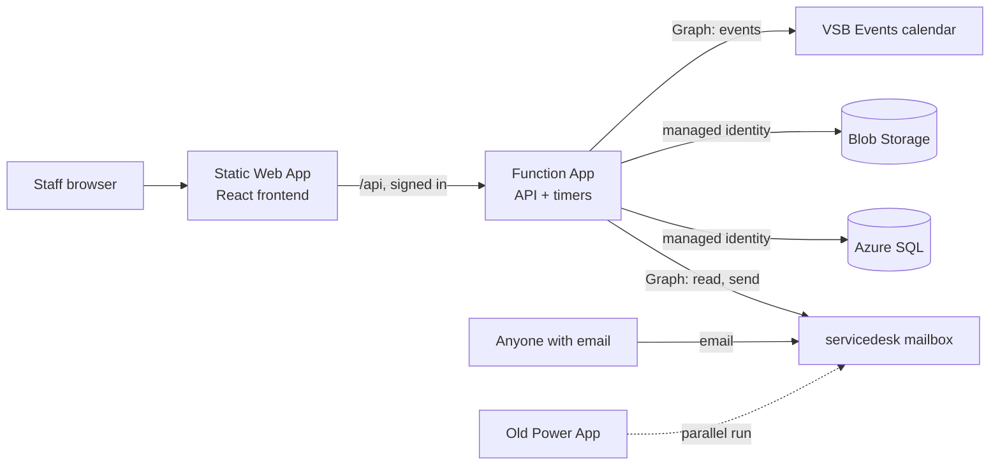

# VSB Service Desk Design

Version 5, approved 2026-10-29, with the email sections brought up to date
on 2026-10-30. Version 4 was approved on 2026-10-05.

## Summary

The new service desk replaces the current Power App with one ticket system on
Azure. Staff use a web app or email, outside people use email only, and IT works
every ticket from one queue.

- **Two ways in.** Staff sign in with their vsb.org Microsoft account to create
  tickets and see their active and closed ones. Anyone can email
  `servicedesk@vsb.org` to open a ticket. People without a vsb.org account never
  see the app.
- **Email both ways.** Technician replies are emailed from
  `servicedesk@vsb.org`, and the requester's email replies land on the same
  ticket.
- **Automatic emails.** "Ticket received" on creation. When a ticket is waiting
  on the requester, a warning goes out after 3 business days, and the ticket
  closes automatically with a survey on business day 4.
- **Survey.** A built-in 1 to 5 rating with an optional comment, sent on every
  close.
- **IT technicians only.** One shared queue, worked by technicians. A new ticket
  emails the whole IT team, and a requester's reply emails the assigned
  technician.
- **One form that adapts to the ticket type.** The requester picks a Ticket Type
  first, and the form shows only that type's fields, in a Zendesk-style layout.
  Which fields each type shows is set in Settings.
- **Everything configurable.** Every pick-list is a lookup table managed on a
  Settings page, in a star schema.
- **Three ticket types.** Support, Access & Equipment (with Onboarding,
  Access & Equipment Change and Off Boarding under it) and Equipment Rental.
  Costs are tracked from inventory and per-person software licenses. There is no
  approval step.
- **Equipment Rental / Event Booking.** Staff book a conference room,
  equipment, or both on one form, and it becomes one ticket. HR confirms the
  room part and never sees the equipment. IT handles the equipment part and
  never sees room-only requests. The app puts events on the VSB Events shared
  calendar.
- **Rich text.** Descriptions, replies, notes, booking comments and the booking
  guidelines use a rich text editor, and screenshots can be pasted straight
  into the text.
- **Reports later.** Reports are not in the first version.
- **Switchover.** Every old ticket is imported once from a SharePoint CSV
  export, and both systems run side by side on the same mailbox while you test.

## What changed in version 5

Decided with AIdan on 2026-10-27 and 2026-10-29:

- **One record for rentals and event bookings.** An Equipment Rental / Event
  Booking request is one ticket with one number, whether it has a room,
  equipment or both. The separate EventBookings table and its linked ticket go
  away, and its room details move to a TicketRooms table that hangs off the
  ticket.
- **HR and IT see different parts.** Event Managers see and act on the room
  part only: no equipment, no technician notes. Technicians see the whole
  ticket.
- **Room-only requests stay out of IT's lists.** They show only in HR's Event
  bookings list and never alert the IT team. Adding equipment puts the ticket
  in IT's lists.
- **Room-only tickets close themselves** once the event has ended, or straight
  away when HR declines the room or the requester cancels.
- **Replies and notes on bookings.** HR can reply to the requester and add HR
  notes. HR sees every reply and every HR note, but not technician notes.
- **Rich text with pasted images** in descriptions, replies and notes. The
  booking guidelines get rich text too, without images.
- **Low-stock warning per item.** Each equipment item has its own "Warn at"
  number, or none. The single Settings value goes away.
- **Manager of** on a person's page is a multi-select dropdown instead of a
  list of checkboxes.
- **Everything customizable in the app**, so it can be packaged for another
  organization: the app name, organization name, time zone, staff email
  domains and the service desk mailbox are settings. See "Customizing the
  app".
- **Maintenance mode** (built with the email settings): staff see a "down for
  maintenance" page, technicians and admins keep working, and all mail is read
  from and sent to a testing mailbox.

## What changed in version 4

Decided with AIdan on 2026-10-05:

- **Ticket types.** Down to three: Support, Access & Equipment and Equipment
  Rental. Event Booking and Equipment Provisioning are no longer ticket types.
- **Access & Equipment.** Replaces Access Request, Onboarding and Offboarding.
  Its categories are Onboarding (a new hire gets their equipment and software),
  Off Boarding (the reverse) and Access & Equipment Change (adding or removing
  equipment or software during someone's employment). Equipment that people
  keep now goes out only through these.
- **Categories belong to a ticket type.** Support keeps its own categories,
  Access & Equipment gets the three above, and Equipment Rental has none.
- **Event bookings are their own table**, not tickets. A booking holds the room
  and event details. Only when equipment is requested does it also get a linked
  Equipment Rental ticket, so room-only bookings never reach the IT queue.
- **No SharePoint or Power Automate.** The app emails HR and writes the VSB
  Events calendar itself.
- **New Event Manager role** for HR. Event Managers handle room bookings and
  the room list, and nothing else.

## Architecture

Everything lives in the `rg-VSB-ServiceDesk` resource group in East US. No
passwords or keys are stored anywhere: each piece signs in to the others with
Entra ID.

- **Static Web App, Standard plan.** Hosts the React frontend and handles
  sign-in. Sign-in is limited to the vsb.org tenant through its own Entra app
  registration, so outside accounts are refused at the Microsoft login screen.
- **Function App, Flex Consumption, Node 20.** Linked to the Static Web App as
  its backend, so it only accepts requests that came through the signed-in site.
  It runs the HTTP API and two timer jobs: the mailbox check every 2 minutes and
  the waiting-on-requester check every hour.
- **Azure SQL.** Your existing `db-VSB-ServiceDesk` on `sv-vsb-servicedesk`. The
  Function App signs in with its managed identity, and you sign in with your own
  account when developing locally.
- **Blob Storage.** Holds attachments in a private container. Files are only
  downloaded through the API, after it checks that the person may see the
  ticket.
- **Microsoft Graph.** The Function App's managed identity gets Mail.ReadWrite and
  Mail.Send. Exchange RBAC for Applications limits both to
  `servicedesk@vsb.org`, so it cannot touch any other mailbox. It also needs
  write access to the VSB Events group calendar (see Event booking).
- **Application Insights.** Collects logs and errors from the Function App.

Expected cost is about $10 to $15 a month, mostly the Static Web Apps Standard
plan.

## Database

Tickets sit at the centre of a star schema. Every pick-list is its own lookup
table, and the facts (tickets, messages, items, licenses) point at them by Id.
You run every script yourself, and I'll provide them as numbered SQL files.

### Lookup tables

Every lookup table has `Id`, `Name`, `SortOrder` and `IsActive`. Retired values
disappear from pick-lists, but old tickets keep showing them. All of them are
managed on the Settings page.

- **Statuses.** Extra columns `IsClosed`, `IsWaitingOnRequester` and `Color`.
  Starting values: New, Assigned, In Progress, Awaiting User Response (waiting),
  External Action Needed, Closed (closed).
- **Priorities.** Extra column `Rank`. Starting values: Low, Normal, High,
  Urgent.
- **Categories.** Extra column `TicketTypeId`, so each category belongs to one
  ticket type, plus `ChecklistSource` (onboarding, offboarding or empty).
  Starting values for Support: Phone, Software/Application, iMIS,
  Printers/Copiers, Hardware, Other. For Access & Equipment: Onboarding
  (onboarding checklist), Access & Equipment Change (no checklist) and Off
  Boarding (offboarding checklist). Equipment Rental has none.
- **Subcategories.** Extra column `CategoryId`. You fill these in per category.
- **Sources.** Starting values: Web, Email, Phone, Walk-up, Import.
- **TicketTypeFields.** Which form fields each ticket type shows, and which are
  required: TicketTypeId, CategoryId, FieldKey, IsShown, IsRequired,
  SortOrder. An empty CategoryId applies to the whole type; a filled one only
  applies when that category is picked. This is how the form changes by type
  and, for Access & Equipment, by category.
- **TicketTypes.** Extra columns `UsesDates`, `UsesInventory`, `UsesLicenses`
  and `UsesChecklist`. Starting values: Support, Access & Equipment, Equipment
  Rental.
- **BookingStatuses.** The room part's status, shown as Room status. Extra
  columns `IsActiveBooking` and `Color`. Starting values: Pending, Confirmed
  (both active), Declined, Cancelled.
- **Rooms.** Name only. Managed by Event Managers in the Event Booking view, not
  on the Settings page.
- **Departments.** Your existing table, with an added `Code` column for short
  codes like RM and AS.
- **Holidays.** Date and Name. These dates are skipped when counting business
  days.
- **UserTypes.** Starting values: Staff, External, Shared Mailbox.
- **Roles.** Extra column `IsEventManager`. Starting values: Requester,
  Event Manager, Technician, Admin.
- **BillingPeriods.** Extra column `MonthsPerPeriod`. Starting values: Monthly
  (1), Yearly (12).

The `IsWaitingOnRequester` flag drives the 3 and 4 day timers, and the
`IsClosed` flag sends the survey. Because the logic follows the flags, you can
rename statuses freely.

### Catalog tables

- **InventoryItems.** Name, UnitCost (USD), QuantityOwned, LowStockAt,
  IsActive. `LowStockAt` is the number at or below which Available turns
  orange on the Inventory page. Empty means the item never warns.
- **Software.** One license: Name, CostPerSeat (USD), BillingPeriodId,
  SeatsPurchased, ApplicationId (the software it's for), ImisAccess (read or
  edit, for iMIS licenses), IsActive.
- **Applications.** The friendly software names on the Onboarding form:
  Name, Description, IsImis, SortOrder, IsActive.
- **ImisModules, ImisRoles, ImisGroups.** What IT can give in iMIS. Each
  module gets a level from 0 to 8 (7 isn't used).
- **JobTitles.** Each department's titles: DepartmentId, Name, SortOrder,
  IsActive.
- **OnboardingDefaults.** What a title gets (JobTitleId empty for the
  general set): Kind (item, app, printer, mailbox, calendar, phone,
  imisModule, imisRole, imisGroup), RefId, SoftwareId (the exact license for
  an app), Level, Text, IsRequired.
- **Printers.** Name, Model, Location, DepartmentId, IsActive.
- **InkCartridges.** Name (type), Color, QuantityOnHand (never below zero),
  LowStockAt, UnitCost. **InkCartridgePrinters** says which printers each
  works with.
- **PersonAccess.** Access a person holds besides equipment and seats:
  UserId, Kind, RefId or Text, Level, when and on which ticket it was given
  and removed.

### The two core tables

Ticket data and conversation data are kept apart:

- **Tickets** holds the ticket data, one row per ticket: TicketTypeId, StatusId,
  PriorityId, CategoryId, SubcategoryId, SourceId, RequesterId, ForUserId,
  TechnicianId, DepartmentId, Subject, Description, StartDate, EndDate,
  StartAt, EndAt, CreatedAt, UpdatedAt, WaitingSince, WarningSentAt, ClosedAt,
  LegacyId. `StartAt` and `EndAt` are the date and time of a rental or event,
  and `StartDate` and `EndDate` always hold their dates, which is what the
  equipment counts use.
- **TicketConversations** holds the conversation, one row per response, linked
  to its ticket by TicketId: AuthorId, Body, IsTechnicianNote,
  VisibleToEventManagers, Direction (in or out), EmailMessageId, CreatedAt. A
  note has `IsTechnicianNote` set, so the requester never sees it. An HR note
  also has `VisibleToEventManagers` set.

The requester's first message is the ticket's Description. Every reply after
that, from either side, and every technician note is a row in
TicketConversations, in time order. `ForUserId` is the person the ticket is
about when that isn't the requester, such as a new hire, a leaver, or the person
getting access.

### Supporting fact tables

- **TicketCc.** One CC address on a ticket: TicketId, Email.
- **Attachments.** One file: TicketId, ConversationId (empty when attached to
  the original request), FileName, ContentType, SizeBytes, BlobPath, IsInline.
  An image pasted into the text is an attachment with `IsInline` set, so it
  shows in the text rather than in the attachment list.
- **TicketItems.** Inventory on a ticket: TicketId, InventoryItemId, Quantity,
  UnitCostAtTime, OutAt, ReturnedAt.
- **LicenseAssignments.** One seat held by one person: UserId, SoftwareId,
  CostPerSeatAtTime, AssignedAt, AssignedTicketId, RemovedAt, RemovedTicketId.
- **ChecklistItems.** One onboarding or offboarding step: TicketId, Label,
  InventoryItemId, SoftwareId, LicenseAssignmentId, IsDone, DoneById, DoneAt.
- **Surveys.** One survey per closed ticket: TicketId, Token, Rating (1 to 5),
  Comment, SentAt, AnsweredAt.
- **TicketEvents.** One field change, for history, such as a status or
  technician change: TicketId, ActorId, Field, OldValue, NewValue, At. These
  stay out of the conversation.
- **InboundEmails.** One mailbox message already processed: EmailMessageId
  (unique), ReceivedAt, TicketId.
- **TicketRooms.** The room part of an Equipment Rental / Event Booking
  ticket, at most one per ticket: TicketId, RoomId, AttendeeCount,
  Refreshments, Foia, LunchCatered, BookingStatusId, CalendarEventId,
  ConfirmedById, ConfirmedAt. The title is the ticket's Subject, the comments
  are its Description, and the times are its `StartAt` and `EndAt`. Changes go
  in TicketEvents like any other ticket change.

Ticket numbers display padded to 7 digits. Imported tickets keep their old
numbers, and new tickets start at 0010000, so the two systems never use the same
number during the parallel run. `DepartmentId` is copied onto the ticket when
it's created, so moving a person to another department later doesn't rewrite
history. `UnitCostAtTime` and `CostPerSeatAtTime` freeze the price used, so a
price change doesn't rewrite past costs.

### Changes to your existing tables

- **Users.** Keep `Id` and `Email` (made unique). Add `DisplayName`,
  `UserTypeId`, `RoleId`, `DepartmentId` and `IsActive`. External senders and
  shared mailboxes are added automatically the first time they email.
- **Departments.** Add `Code`, `SortOrder` and `IsActive`.
- **Existing test tickets.** The version 4 script moves test tickets of the
  old Access Request, Onboarding and Offboarding types to Access & Equipment
  with the matching category, retires the Event Booking and Equipment
  Provisioning types, and leaves their test tickets as they are.
- **Existing bookings.** Script 11 turns each EventBookings row into the
  room part of a ticket: a booking that already had a linked Equipment Rental
  ticket joins that ticket, and a room-only booking gets a new ticket. Its
  history moves to TicketEvents, and the EventBookings and BookingEvents
  tables are then dropped. Script 11 also copies today's low-stock setting
  onto every equipment item, so nothing changes until you edit them.
- **UserDepartments.** Renamed `DepartmentManagers`: one row per manager per
  department, so a manager can be linked to several departments. Each person's
  own department is the single `Users.DepartmentId`.

### Settings table

One row per setting: the organization settings (see "Customizing the app"),
the outgoing email switch, the 3 and 4 business-day limits, the IT team's
notification addresses, the status a ticket
switches to when the requester replies, how often to check the mailbox, the
events calendar address, and the event booking Guidelines text (edited by Event
Managers).

## Screens

The technician screens follow the layout your team already knows from the Power
App. The staff screens follow Zendesk.

### Staff

- **Submit a request.** Ticket Type comes first, and the rest of the form
  changes to that type's fields. The starting field sets are below, and you can
  change them in Settings.
- **My tickets.** Two tabs, Active and Closed, showing ticket number, subject,
  status, technician and last update.
- **Ticket.** The conversation without technician notes, attachments, a reply
  box, and the survey once the ticket is closed.
- **Equipment Rental / Event Booking.** The booking form, described under
  Event booking.
- **My rentals and events.** Their upcoming and past requests, each with its
  room status and equipment status. Each one opens as an ordinary ticket page,
  where they can reply, change it or cancel it.

Starting form fields by ticket type. Every type also has Subject, Description,
Priority, CC and Attachments.

- **Support.** Category and Subcategory.
- **Access & Equipment.** Category first (Onboarding, Access & Equipment
  Change or Off Boarding), then that category's fields:
  - **Onboarding.** New hire's first name, last name, display name,
    department, job title and start date, then equipment, software they
    need, shared mailboxes, calendars, phone lines and printers, filled in
    from the job title's defaults.
  - **Access & Equipment Change.** Who it's for, and the equipment or software
    to add or remove.
  - **Off Boarding.** Who is leaving, and their last day.
- **Equipment Rental / Event Booking.** Uses the booking form instead of the
  usual fields. A room is optional, so a loan with no room, like a laptop for a
  trip, uses the same form.

### Technicians

- **Queue.** Columns Title, Assigned To, Category, Requester, Status, Created
  Date and Department, with rows coloured by status. Filters for status,
  priority, category, type, technician and department. Search by number, subject
  or requester.
- **Ticket.** A ticket list on the left, the conversation in the middle, and a
  side panel with Status, Category, Subcategory, Priority, Type, Technician,
  Requester and Department. Below the conversation are Reply, Technician note,
  Attachments and Close ticket.
- **Ticket extras.** Shown depending on the ticket type and category: start and
  end dates, inventory lines with costs, license seats, or an onboarding or
  offboarding checklist. An Equipment Rental / Event Booking ticket shows a
  Room panel and an Equipment panel beside the conversation.
- **Rentals & Events.** Every request with equipment, with its room status and
  equipment status. Room-only requests don't appear here or in the ticket
  lists.
- **New ticket.** The staff form, plus Requester (any user, including outside
  people), Type and Source, for phone calls and walk-ups.
- **Inventory.** Item types with unit cost, quantity owned, how many are out
  now, and upcoming bookings.
- **Licenses.** Each software's seats purchased, seats in use, cost per seat and
  total cost, and who holds each seat.
- **People.** Everyone in Users, with type, department and role. Admins promote
  a user to Event Manager, Technician or Admin here. A person's page lists
  their tickets, equipment and licenses.

### Event Managers

- **Event bookings.** Their only list besides their own tickets. It lists
  every ticket with a room, with Pending ones first and a filter by date, room
  and room status. Two active bookings for the same room at overlapping times
  are flagged, as a hint only. It never shows equipment.
- **Booking page.** The same ticket page technicians use, cut down to the room
  part: the event details, the Room panel with Confirm and Decline, every reply,
  HR notes, and the history of room and event changes. They can reply to the
  requester, add an HR note and change the event details. They don't see the
  equipment, technician notes, or the ticket's status, priority and technician.
- **Rooms and Guidelines.** They add, rename and retire rooms, and edit the
  Guidelines text shown on the booking form.

### Admin

- **Settings.** One tab per lookup table (add, rename, reorder, retire), plus
  the onboarding defaults, the email switch, the day limits, roles and the
  organization settings.

## Email flow

The app checks the desk's mailbox through Microsoft Graph on the "Minutes
between mailbox checks" setting (2 today). It never moves, deletes or marks a
message, and it sends every email from the same mailbox. Every part has its
own switch in Settings > Email, and every switch starts Off.

### Incoming email

1. Read messages received since the last check (and after "Only read mail
   received after") from the Inbox, skipping any already recorded in
   `InboundEmails`. This lets the old Power App keep processing the same
   mailbox during the trial.
2. Skip automatic mail (out-of-office replies, delivery failures, anything
   marked Auto-Submitted) and mail the app sent itself, so it never emails
   itself in a loop.
3. Decide whether it's a reply. It is if the subject carries `Ticket #0010023`
   (this app) or `##0005854##` (the old desk, matched on imported numbers
   too), or if its reply headers point at an email the app sent. A reply to
   a merged ticket goes to the ticket it was merged into. A reply is added to
   the ticket, stops the waiting clock and sets the "after the requester
   replies" status. A reply always reopens a closed ticket, however old; if
   reopening would over-book equipment, the reply is still added and a note
   tells the technician.
4. Otherwise, create a ticket: Source Email, the type from Settings, the
   subject without "RE:", "FW:" or "EXT:", the message and its files, and
   everyone else on the email as CCs.
5. Find or create the sender in Users. Unknown staff-domain senders become
   Staff (or Shared Mailbox, with the optional User.Read.All permission) and
   everyone else External. With "Create accounts for new senders" off, their
   mail waits in Held mail for a technician to accept or dismiss.

Files over the "largest email" size are not saved; the ticket says which, and
they stay in the mailbox. A message that fails is kept in Held mail with the
error, to try again.

### Outgoing email

Each has its own switch:

- **Ticket received.** The requester and CCs, with the ticket number.
- **New ticket alert.** The IT team addresses, with the description and a
  link. Room-only requests go to HR instead (room request alert).
- **Technician and HR replies.** The requester and CCs get the reply, its
  attachments and pasted pictures, and the conversation below, newest first.
  Notes and automatic emails are never included. A reply whose switch is off
  is still saved and shows "Not emailed".
- **Requester replies.** The assigned technician, or the IT team if nobody is
  assigned.
- **Waiting on you.** The requester, on the warning business day.
- **Closed and survey.** The requester, with the 1 to 5 survey links. With
  both switches on they come as one email. Never for room-only requests or a
  ticket merged into another.
- **Bookings.** Room confirmed or declined to the requester; changes and
  cancellations to HR and to the technician holding the equipment.

Every email uses the branded layout: the logo in a bar of the Appearance
header color, the message, and a "View your ticket" button for staff. Outside
people can't sign in, so they get no button and are asked to reply instead.
Every subject carries `Ticket #0010023` so replies thread back. Automatic
emails are logged in the technician-only history, never in the conversation.
Technician notes never leave the app.

### Waiting on the requester

1. When a technician replies, the status changes to Awaiting User Response
   unless the technician picks another status. Any status flagged
   `IsWaitingOnRequester` starts the clock and sets `WaitingSince`.
2. A job wakes every quarter hour and does the day's work once, at 8:15 in
   the morning in the desk's time zone, on business days. At 3 business days
   with no reply it sends the warning once.
3. At 4 business days, with "Close tickets with no answer" on, it closes the
   ticket, which sends the closed email and survey when those are on.
4. If the requester replies at any point, the clock stops, the status switches
   to the one chosen in Settings, and the technician is emailed.

Business days are Monday to Friday, skipping any date in the Holidays list.

### The email switches

Settings > Email has three tabs, Incoming, Outgoing and Automations, with a
switch for each function above, plus Held mail, Notifications (IT team, HR
and error alert addresses) and the templates. Every switch starts Off, so
you can turn on, for example, replies without ticket creation, or technician
replies without the closed email. An Email status line shows the last
mailbox check, anything failing and the mail sent in the last day. When a
job starts failing, the error alert recipients get one email, and one more
when it works again.

### Maintenance mode

An admin turns it on in Settings > System > Access and maintenance. While
it's on:

- Staff and HR who sign in see a "down for maintenance" page. Technicians and
  admins keep working as normal.
- Mail is read only from the testing mailbox, and every outgoing email goes
  only to the testing mailbox, with the real recipients written at the top,
  so nothing reaches real requesters.

A separate switch there, "Staff can use the web app", keeps staff out with a
"coming soon" page before the desk opens to them (technician-first start).

## Inventory, licenses, onboarding and offboarding

These are ordinary tickets with extra panels. The ticket type decides which
panels appear. Costs are recorded for tracking only and are never billed.

- **Equipment Rental.** Start date, end date and inventory lines. Items count as
  out for those dates, and the app warns you if a booking would need more than
  you own. Marking a line Returned puts the items back. A rental linked to an
  event booking takes its dates from the booking.
- **Access & Equipment, Onboarding.** The form starts from the job title's
  defaults (or the general defaults); required equipment and software can't
  be removed there. The checklist lists each item, each software with the
  exact license from the defaults (a dropdown changes it), each access entry,
  and, when iMIS is asked for, the title's iMIS module levels, roles and
  groups. A read only iMIS license gets the StaffReadOnly role and no module
  levels. Ticking a line hands out the item, assigns the seat or records the
  access on the person.
- **Support, Low ink.** A subcategory marked "Asks which printer and ink"
  asks for the printer and which of its cartridges are low. The technician
  sees each cartridge's stock and clicks Take 1, which lowers the count.
- **Access & Equipment, Access & Equipment Change.** Inventory lines and
  software seats for the person, in both directions. Adding gives them
  equipment to keep or a new seat at the current seat cost. Removing returns
  equipment they hold or frees a seat. There is no approval step.
- **Access & Equipment, Off Boarding.** A checklist of everything the person
  currently holds, including mailboxes, calendars, phone lines, printers and
  iMIS access. Marking a line done returns the equipment, frees the seat or
  records the access as removed.
- **Support.** No extra panel.

The numbers are worked out like this:

- **Available now** = quantity owned − items out today − items booked for today.
- **Ticket cost** = the sum of quantity × unit cost for its inventory lines,
  plus the seat cost of any licenses it granted.
- **License spend** = active seats × cost per seat, shown monthly and yearly
  using each software's billing period.
- **Prices are frozen.** The price is saved on each line, so changing a price in
  Settings later doesn't change past costs.

## Event booking

Room booking and equipment rental are one stop for staff. Each request is one
Equipment Rental / Event Booking ticket. Its room part lives in TicketRooms and
HR works it as Event Managers. Its equipment part is the ticket's inventory
lines and technicians work it. There is no SharePoint list and no Power
Automate flow.

### The booking form

It matches the current Power App form. Fields marked * are required.

- Title*, Start date and time*, End date and time*, Location (picked from the
  room list, or No room needed) and Attendee Count* when a room is picked.
- Refreshments*, FOIA* and Will Lunch Be Catered*, each a Yes or No switch,
  when a room is picked.
- Items to Checkout, picking inventory items and quantities.
- User Comments, in the rich text editor, for notes to HR or IT.
- A Guidelines button that shows the text Event Managers keep up to date.

A request needs a room, equipment or both. The form doesn't check whether the
room is free, because room availability can't be tracked reliably.

### What happens

1. **Submit.** One ticket is created. With a room, its room status is
   Pending, it's added to the VSB Events calendar with the room as the event's
   location, as the current flow does, and every Event Manager is emailed. With
   equipment, the IT team gets the usual new ticket email.
2. **Confirm or decline.** An Event Manager confirms or declines the room. The
   requester is emailed either way. Declining removes the calendar event and
   closes the ticket, with the reason added as a reply to the requester.
3. **Changes.** The requester, an Event Manager or a technician can change the
   event details, including moving the meeting. Only the requester and
   technicians can change the equipment. The calendar event is updated and the
   Event Managers are emailed. The equipment dates move with the event and the
   assigned technician is emailed. Adding equipment to a room-only request puts
   it in IT's lists and alerts the IT team. A change doesn't send a confirmed
   room back to Pending.
4. **Cancel.** The requester, an Event Manager or a technician can cancel. The
   calendar event is removed, Event Managers are emailed, and the ticket is
   closed.
5. **Equipment.** Technicians check the items out to the requester and mark them
   returned, as on any rental, and close the ticket once everything is back.
6. **Room-only close.** A ticket with a room and no equipment closes itself once
   the event has ended. A job checks every hour. These closes don't send the
   closed email or the survey, since IT did no work on them.

Every change is recorded in TicketEvents. Event Managers see only the room and
event changes in the history.

### Who can do what

- **Requester.** Books, sees and changes their own requests, and replies on
  them.
- **Event Manager.** Sees every ticket with a room, but only its room part.
  Confirms and declines, changes event details, replies to the requester, adds
  HR notes, and manages rooms and the Guidelines text. No access to equipment,
  technician notes, other tickets or the rest of Settings.
- **Technician.** The whole ticket, including the equipment and every note.
  Room-only tickets are left out of their lists, but they can still open one.
- **Admin.** Everything a technician can do, plus Confirm and Decline.

### The VSB Events calendar

The calendar is the Microsoft 365 group VSB Events
(`VSBEventsCalender@vsb.org`). The app writes events without attendees, so it
sends no invitations. Members who follow the group still get the group's usual
notifications, as they do now.

Microsoft Graph only officially lets an app write to a group calendar on behalf
of a signed-in person, not as the app itself. The plan is:

1. Give the Function App the Graph application permission Calendars.ReadWrite,
   limited to the group's mailbox with the same Exchange RBAC for Applications
   scope used for `servicedesk@vsb.org`, and test writing an event to the group
   calendar. This works for group mailboxes in practice, but Microsoft doesn't
   document it.
2. If that test fails, a signed-in route: each Event Manager or requester's
   own sign-in writes the event when they submit or change it. That needs the
   Group.ReadWrite.All delegated permission, and every requester would have to
   be able to write to the group calendar.

Calendar writes have their own switch ("Write room bookings to the events
calendar", Automations), and booking emails have theirs under Outgoing. All
start Off, so nothing reaches the calendar or HR until you turn them on. A
booking is added marked "[Pending]" and tentative, updated when it changes or
is confirmed, and removed when it is declined, cancelled or loses its room. A
failed write is noted in the ticket's history and in the Email status.

## Rich text

Ticket descriptions, replies, notes, booking comments and the booking
guidelines are written in a rich text editor with a small toolbar: bold,
italic, underline, bulleted and numbered lists, links and clear formatting.
Text pasted from Word or Outlook keeps that formatting.

- **Pasted images.** A screenshot pasted into a description, reply or note is
  uploaded with the ticket as an inline attachment and shown in place. It
  follows the same size limit and access checks as any attachment, so an image
  in a technician note is never shown to the requester. The guidelines take
  text formatting only.
- **Stored as HTML.** The server keeps only the tags the toolbar can make, plus
  images that point at the ticket's own attachments. Anything else, such as
  scripts, styles or outside images, is removed before saving.
- **Email.** Replies go out as HTML email, with pasted images embedded in the
  message. Formatting in incoming email is kept the same way.
- **Existing text.** Script 11 turns the plain text already saved into the
  same format, keeping its line breaks.

## Customizing the app

The aim is an app that can be packaged for another organization, so nothing
about VSB is built into the code. Admins set these in Settings, Organization,
Name, time zone and mailbox:

- **App name.** Shown in the header, on the sign-in page and in the browser tab
  (VSB Service Desk).
- **Organization name.** Used in messages, such as who can sign in (Virginia
  State Bar).
- **Time zone.** Event times and when room-only bookings close
  (America/New_York).
- **Staff email domains.** Who can sign in, and who counts as staff when a
  technician logs a ticket for someone (vsb.org). The admin's own domain must
  stay in the list.
- **Service desk mailbox.** Where tickets are emailed to and every email is
  sent from (`servicedesk@vsb.org`).
- **Testing mailbox.** The one address mail goes to and is read from in
  maintenance mode. Empty until it's needed.

The logo (Settings, Logo), the colors (Settings, Appearance), every list and
the email templates were already settings.

## Migration and parallel run

Old tickets come over once from a CSV export, and then both systems run side by
side until you switch off the Power App.

1. **Export.** You export the SharePoint lists behind the Power App to CSV:
   tickets, plus any separate lists for notes, rentals, access requests or
   room bookings. I'll need a sample of each before writing the import.
2. **Import.** A Node script you run once loads the CSVs into the new tables. It
   keeps each old ticket number, creates any lookup value it doesn't recognise
   (a status or category name, for example), and matches requesters by email,
   creating any that are missing. Each imported ticket gets Source Import and
   its original `LegacyId`.
3. **Attachments.** The import also copies each old ticket's SharePoint
   attachments into Blob Storage through Microsoft Graph. This step is optional,
   and can be skipped if it proves difficult, leaving the files in SharePoint.
4. **Check.** The script prints counts per status and category so you can
   compare them with the Power App.
5. **Trial.** Technicians use the app in maintenance mode, where all mail is
   read from and sent to the testing mailbox (`sdtest@vsb.org`), so the old
   desk keeps handling `servicedesk@vsb.org` alone.
6. **Cutover.** Turn off the Power App's email flow, then turn maintenance
   mode off and the email switches on.

Tickets created in the old system after the export won't be imported. New
tickets start at 0010000, so they never clash with the old system's numbers.

## Azure setup steps

You do these yourself as global admin. The build will include a README with the
exact commands for each step.

1. Run the SQL scripts against `db-VSB-ServiceDesk` in order.
2. Create a Storage account with a private `attachments` container.
3. Create the Function App (Flex Consumption, Node 20, East US) and turn on its
   system-assigned managed identity.
4. Give that identity access: a contained SQL user with read and write roles,
   Storage Blob Data Contributor on the storage account, and mail access.
5. Give the mail access with Exchange RBAC for Applications (Mail.ReadWrite,
   Mail.Send and Calendars.ReadWrite), scoped to `servicedesk@vsb.org`,
   `sdtest@vsb.org` and the events calendar, using Exchange Online PowerShell.
6. Create an Entra app registration for sign-in, single tenant, with the Static
   Web App's callback URL.
7. Create the Static Web App on the Standard plan, connect it to
   `Virginia-State-Bar/ServiceDesk`, and link the Function App as its backend.
8. Add the app settings: SQL server and database names, storage account name,
   mailbox address and the sign-in app's client ID and secret setting.
9. Make yourself Admin by running the provided SQL script, then sign in and fill
   in the lookup tables on the Settings page.

## Build order

Each step is its own pull request to `Virginia-State-Bar/ServiceDesk`, so you
can review and test as it lands.

1. **Database.** The SQL scripts and starting lookup values.
2. **API core.** Sign-in, users, lookups, settings, tickets, messages and
   attachments.
3. **Frontend.** The staff form, My tickets, the technician queue and ticket
   page, and the Settings page.
4. **Email.** Reading the mailbox, sending email, notifications and the email
   switch.
5. **Timers and survey.** The 3 and 4 business-day rules and the survey page.
6. **Inventory and licenses.** Item and software catalogs, ticket panels, and
   the onboarding and offboarding checklists.
7. **Ticket types and event booking.** The three ticket types, categories per
   type, the Event Manager role, the booking form, the Event Booking view and
   the calendar.
8. **Import.** The one-time CSV import script.
9. **Parallel run and cutover.**
