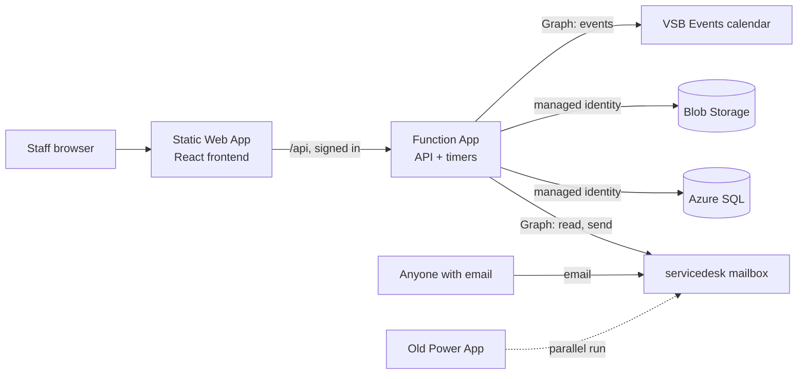

# VSB Service Desk Design

Version 4, 2026-10-05.

## Summary

The new service desk replaces the current Power App with one ticket system on
Azure. Staff use a web app or email, outside people use email only, and IT works
every ticket from one queue.

- **Two ways in.** Staff sign in with their vsb.org Microsoft account to create
  tickets and see their active and closed ones. Anyone can email
  `servicedesk@vsb.org` to open a ticket. People without a vsb.org account never
  see the app.
- **Email both ways.** Technician replies are emailed from
  `servicedesk@vsb.org`, and the requester's email replies land on the same
  ticket.
- **Automatic emails.** "Ticket received" on creation. When a ticket is waiting
  on the requester, a warning goes out after 3 business days, and the ticket
  closes automatically with a survey on business day 4.
- **Survey.** A built-in 1 to 5 rating with an optional comment, sent on every
  close.
- **IT technicians only.** One shared queue, worked by technicians. A new ticket
  emails the whole IT team, and a requester's reply emails the assigned
  technician.
- **One form that adapts to the ticket type.** The requester picks a Ticket Type
  first, and the form shows only that type's fields, in a Zendesk-style layout.
  Which fields each type shows is set in Settings.
- **Everything configurable.** Every pick-list is a lookup table managed on a
  Settings page, in a star schema.
- **Three ticket types.** Support, Access & Equipment (with Onboarding,
  Access & Equipment Change and Off Boarding under it) and Equipment Rental.
  Costs are tracked from inventory and per-person software licenses. There is no
  approval step.
- **Event booking.** Staff book a conference room, with any equipment they
  need, on one form. HR confirms the room in its own Event Booking view, and
  the app puts the event on the VSB Events shared calendar. Equipment creates a
  linked Equipment Rental ticket for technicians.
- **Reports later.** Reports are not in the first version.
- **Switchover.** Every old ticket is imported once from a SharePoint CSV
  export, and both systems run side by side on the same mailbox while you test.

## What changed in version 4

Decided with AIdan on 2026-10-05:

- **Ticket types.** Down to three: Support, Access & Equipment and Equipment
  Rental. Event Booking and Equipment Provisioning are no longer ticket types.
- **Access & Equipment.** Replaces Access Request, Onboarding and Offboarding.
  Its categories are Onboarding (a new hire gets their equipment and software),
  Off Boarding (the reverse) and Access & Equipment Change (adding or removing
  equipment or software during someone's employment). Equipment that people
  keep now goes out only through these.
- **Categories belong to a ticket type.** Support keeps its own categories,
  Access & Equipment gets the three above, and Equipment Rental has none.
- **Event bookings are their own table**, not tickets. A booking holds the room
  and event details. Only when equipment is requested does it also get a linked
  Equipment Rental ticket, so room-only bookings never reach the IT queue.
- **No SharePoint or Power Automate.** The app emails HR and writes the VSB
  Events calendar itself.
- **New Event Manager role** for HR. Event Managers handle room bookings and
  the room list, and nothing else.

## Architecture

Everything lives in the `rg-VSB-ServiceDesk` resource group in East US. No
passwords or keys are stored anywhere: each piece signs in to the others with
Entra ID.

- **Static Web App, Standard plan.** Hosts the React frontend and handles
  sign-in. Sign-in is limited to the vsb.org tenant through its own Entra app
  registration, so outside accounts are refused at the Microsoft login screen.
- **Function App, Flex Consumption, Node 20.** Linked to the Static Web App as
  its backend, so it only accepts requests that came through the signed-in site.
  It runs the HTTP API and two timer jobs: the mailbox check every 2 minutes and
  the waiting-on-requester check every hour.
- **Azure SQL.** Your existing `db-VSB-ServiceDesk` on `sv-vsb-servicedesk`. The
  Function App signs in with its managed identity, and you sign in with your own
  account when developing locally.
- **Blob Storage.** Holds attachments in a private container. Files are only
  downloaded through the API, after it checks that the person may see the
  ticket.
- **Microsoft Graph.** The Function App's managed identity gets Mail.Read and
  Mail.Send. Exchange RBAC for Applications limits both to
  `servicedesk@vsb.org`, so it cannot touch any other mailbox. It also needs
  write access to the VSB Events group calendar (see Event booking).
- **Application Insights.** Collects logs and errors from the Function App.

Expected cost is about $10 to $15 a month, mostly the Static Web Apps Standard
plan.

## Database

Tickets sit at the centre of a star schema. Every pick-list is its own lookup
table, and the facts (tickets, messages, items, licenses) point at them by Id.
You run every script yourself, and I'll provide them as numbered SQL files.

### Lookup tables

Every lookup table has `Id`, `Name`, `SortOrder` and `IsActive`. Retired values
disappear from pick-lists, but old tickets keep showing them. All of them are
managed on the Settings page.

- **Statuses.** Extra columns `IsClosed`, `IsWaitingOnRequester` and `Color`.
  Starting values: New, Assigned, In Progress, Awaiting User Response (waiting),
  External Action Needed, Closed (closed).
- **Priorities.** Extra column `Rank`. Starting values: Low, Normal, High,
  Urgent.
- **Categories.** Extra column `TicketTypeId`, so each category belongs to one
  ticket type, plus `ChecklistSource` (onboarding, offboarding or empty).
  Starting values for Support: Phone, Software/Application, iMIS,
  Printers/Copiers, Hardware, Other. For Access & Equipment: Onboarding
  (onboarding checklist), Access & Equipment Change (no checklist) and Off
  Boarding (offboarding checklist). Equipment Rental has none.
- **Subcategories.** Extra column `CategoryId`. You fill these in per category.
- **Sources.** Starting values: Web, Email, Phone, Walk-up, Import.
- **TicketTypeFields.** Which form fields each ticket type shows, and which are
  required: TicketTypeId, CategoryId, FieldKey, IsShown, IsRequired,
  SortOrder. An empty CategoryId applies to the whole type; a filled one only
  applies when that category is picked. This is how the form changes by type
  and, for Access & Equipment, by category.
- **TicketTypes.** Extra columns `UsesDates`, `UsesInventory`, `UsesLicenses`
  and `UsesChecklist`. Starting values: Support, Access & Equipment, Equipment
  Rental.
- **BookingStatuses.** Extra columns `IsActiveBooking` and `Color`. Starting
  values: Pending, Confirmed (both active), Declined, Cancelled.
- **Rooms.** Name only. Managed by Event Managers in the Event Booking view, not
  on the Settings page.
- **Departments.** Your existing table, with an added `Code` column for short
  codes like RM and AS.
- **Holidays.** Date and Name. These dates are skipped when counting business
  days.
- **UserTypes.** Starting values: Staff, External, Shared Mailbox.
- **Roles.** Extra column `IsEventManager`. Starting values: Requester,
  Event Manager, Technician, Admin.
- **BillingPeriods.** Extra column `MonthsPerPeriod`. Starting values: Monthly
  (1), Yearly (12).

The `IsWaitingOnRequester` flag drives the 3 and 4 day timers, and the
`IsClosed` flag sends the survey. Because the logic follows the flags, you can
rename statuses freely.

### Catalog tables

- **InventoryItems.** Name, UnitCost (USD), QuantityOwned,
  IsDefaultForOnboarding, IsActive.
- **Software.** Name, CostPerSeat (USD), BillingPeriodId, SeatsPurchased,
  IsDefaultForOnboarding, IsActive.

### The two core tables

Ticket data and conversation data are kept apart:

- **Tickets** holds the ticket data, one row per ticket: TicketTypeId, StatusId,
  PriorityId, CategoryId, SubcategoryId, SourceId, RequesterId, ForUserId,
  TechnicianId, DepartmentId, Subject, Description, StartDate, EndDate,
  CreatedAt, UpdatedAt, WaitingSince, WarningSentAt, ClosedAt, LegacyId.
- **TicketConversations** holds the conversation, one row per response, linked
  to its ticket by TicketId: AuthorId, Body, IsTechnicianNote, Direction (in or
  out), EmailMessageId, CreatedAt.

The requester's first message is the ticket's Description. Every reply after
that, from either side, and every technician note is a row in
TicketConversations, in time order. `ForUserId` is the person the ticket is
about when that isn't the requester, such as a new hire, a leaver, or the person
getting access.

### Supporting fact tables

- **TicketCc.** One CC address on a ticket: TicketId, Email.
- **Attachments.** One file: TicketId, ConversationId (empty when attached to
  the original request), FileName, ContentType, SizeBytes, BlobPath.
- **TicketItems.** Inventory on a ticket: TicketId, InventoryItemId, Quantity,
  UnitCostAtTime, OutAt, ReturnedAt.
- **LicenseAssignments.** One seat held by one person: UserId, SoftwareId,
  CostPerSeatAtTime, AssignedAt, AssignedTicketId, RemovedAt, RemovedTicketId.
- **ChecklistItems.** One onboarding or offboarding step: TicketId, Label,
  InventoryItemId, SoftwareId, LicenseAssignmentId, IsDone, DoneById, DoneAt.
- **Surveys.** One survey per closed ticket: TicketId, Token, Rating (1 to 5),
  Comment, SentAt, AnsweredAt.
- **TicketEvents.** One field change, for history, such as a status or
  technician change: TicketId, ActorId, Field, OldValue, NewValue, At. These
  stay out of the conversation.
- **InboundEmails.** One mailbox message already processed: EmailMessageId
  (unique), ReceivedAt, TicketId.
- **EventBookings.** One room booking: RequesterId, Title, StartAt, EndAt,
  RoomId, AttendeeCount, Refreshments, Foia, LunchCatered, Comments,
  BookingStatusId, TicketId (the linked Equipment Rental ticket, empty for
  room-only bookings), CalendarEventId, ConfirmedById, ConfirmedAt, CreatedAt,
  UpdatedAt.
- **BookingEvents.** One change to a booking, for history, the same way as
  TicketEvents: BookingId, ActorId, Field, OldValue, NewValue, At.

Ticket numbers display padded to 7 digits. Imported tickets keep their old
numbers, and new tickets start at 0010000, so the two systems never use the same
number during the parallel run. `DepartmentId` is copied onto the ticket when
it's created, so moving a person to another department later doesn't rewrite
history. `UnitCostAtTime` and `CostPerSeatAtTime` freeze the price used, so a
price change doesn't rewrite past costs.

### Changes to your existing tables

- **Users.** Keep `Id` and `Email` (made unique). Add `DisplayName`,
  `UserTypeId`, `RoleId`, `DepartmentId` and `IsActive`. External senders and
  shared mailboxes are added automatically the first time they email.
- **Departments.** Add `Code`, `SortOrder` and `IsActive`.
- **Existing test tickets.** The version 4 script moves test tickets of the
  old Access Request, Onboarding and Offboarding types to Access & Equipment
  with the matching category, retires the Event Booking and Equipment
  Provisioning types, and leaves their test tickets as they are.
- **UserDepartments.** Renamed `DepartmentManagers`: one row per manager per
  department, so a manager can be linked to several departments. Each person's
  own department is the single `Users.DepartmentId`.

### Settings table

One row per setting: the outgoing email switch, the 3 and 4 business-day limits,
the mailbox address, the IT team's notification addresses, the status a ticket
switches to when the requester replies, how often to check the mailbox, the
events calendar address, and the event booking Guidelines text (edited by Event
Managers).

## Screens

The technician screens follow the layout your team already knows from the Power
App. The staff screens follow Zendesk.

### Staff

- **Submit a request.** Ticket Type comes first, and the rest of the form
  changes to that type's fields. The starting field sets are below, and you can
  change them in Settings.
- **My tickets.** Two tabs, Active and Closed, showing ticket number, subject,
  status, technician and last update.
- **Ticket.** The conversation without technician notes, attachments, a reply
  box, and the survey once the ticket is closed.
- **Book an event.** The booking form, described under Event booking.
- **My bookings.** Their upcoming and past bookings, each with its status. They
  can open one to change or cancel it.

Starting form fields by ticket type. Every type also has Subject, Description,
Priority, CC and Attachments.

- **Support.** Category and Subcategory.
- **Access & Equipment.** Category first (Onboarding, Access & Equipment
  Change or Off Boarding), then that category's fields:
  - **Onboarding.** New hire's name, department and start date.
  - **Access & Equipment Change.** Who it's for, and the equipment or software
    to add or remove.
  - **Off Boarding.** Who is leaving, and their last day.
- **Equipment Rental.** Start date, end date, and the items and quantities
  needed. This is for loans with no room, like a laptop for a trip. Rentals
  with a room start from the booking form instead.

### Technicians

- **Queue.** Columns Title, Assigned To, Category, Requester, Status, Created
  Date and Department, with rows coloured by status. Filters for status,
  priority, category, type, technician and department. Search by number, subject
  or requester.
- **Ticket.** A ticket list on the left, the conversation in the middle, and a
  side panel with Status, Category, Subcategory, Priority, Type, Technician,
  Requester and Department. Below the conversation are Reply, Technician note,
  Attachments and Move to Closure.
- **Ticket extras.** Shown depending on the ticket type and category: start and
  end dates, inventory lines with costs, license seats, or an onboarding or
  offboarding checklist. A ticket linked to a booking shows the booking's
  title, room and times, with a link to it.
- **Event bookings.** Technicians and Admins can open the Event Booking view
  and do everything an Event Manager can.
- **New ticket.** The staff form, plus Requester (any user, including outside
  people), Type and Source, for phone calls and walk-ups.
- **Inventory.** Item types with unit cost, quantity owned, how many are out
  now, and upcoming bookings.
- **Licenses.** Each software's seats purchased, seats in use, cost per seat and
  total cost, and who holds each seat.
- **People.** Everyone in Users, with type, department and role. Admins promote
  a user to Event Manager, Technician or Admin here. A person's page lists
  their tickets, equipment and licenses.

### Event Managers

- **Event Booking view.** Their only page besides their own tickets and
  bookings. It lists every booking, with Pending ones first and a filter by
  date, room and status. Two active bookings for the same room at overlapping
  times are flagged, as a hint only.
- **Booking page.** The booking's details, Confirm and Decline buttons, and
  editing of every field. The linked ticket's equipment list is shown read-only
  with its ticket number, but they can't open the ticket or change equipment.
- **Rooms and Guidelines.** They add, rename and retire rooms, and edit the
  Guidelines text shown on the booking form.

### Admin

- **Settings.** One tab per lookup table (add, rename, reorder, retire), plus
  the onboarding defaults, the email switch, the day limits and roles.

## Email flow

The app checks `servicedesk@vsb.org` every 2 minutes through Microsoft Graph. It
never moves or deletes a message, and it sends every email from
`servicedesk@vsb.org`.

### Incoming email

1. Read new messages from the mailbox's Inbox, skipping any message already
   recorded in `InboundEmails`. This lets the old Power App keep processing the
   same mailbox.
2. Skip automatic mail: out-of-office replies, delivery failures, and anything
   sent by `servicedesk@vsb.org` itself, so the app never emails itself in a
   loop.
3. Decide whether it's a reply. It is if the subject carries a ticket number
   like `[#0005689]`, or if its reply headers point at an email the app sent. A
   reply is added to that ticket.
4. Otherwise, create a ticket. Its Source is Email, its Subject and Description
   come from the email, its attachments are saved, and the people on CC are
   added to the ticket's CC list.
5. Find or create the sender in Users. Unknown vsb.org senders become Staff,
   shared mailboxes become Shared Mailbox, and everyone else becomes External.

### Outgoing email

- **Ticket created.** The requester and CC get "We received your request" with
  the ticket number. The whole IT team gets a new ticket alert with a link.
- **Technician replies.** The requester and CC get the reply text and any
  attachments.
- **Requester replies.** The assigned technician gets a reply alert with a link,
  or the whole IT team if nobody is assigned.
- **Business day 3 of waiting.** The requester gets a warning that the ticket
  closes tomorrow unless they reply.
- **Ticket closed.** The requester gets a closed notice with the 1 to 5 survey
  links, whether a technician closed it or the day-4 rule did.

Technician notes never leave the app. Every subject carries the ticket number,
like `[#0005689]`, so replies thread back to the right ticket.

### Waiting on the requester

1. When a technician replies, the status changes to Awaiting User Response
   unless the technician picks another status. Any status flagged
   `IsWaitingOnRequester` starts the clock and sets `WaitingSince`.
2. A job runs every hour on weekdays. At 3 business days with no reply from the
   requester, it sends the warning once.
3. At 4 business days, it closes the ticket, which sends the closed email with
   the survey.
4. If the requester replies at any point, the clock stops, the status switches
   to the one chosen in Settings, and the technician is emailed.

Business days are Monday to Friday, skipping any date in the Holidays list.

### The email switch for the parallel run

Settings has a three-way switch for outgoing mail:

- **Off.** Nothing is sent.
- **IT only.** Emails go only to IT team addresses, for testing.
- **On.** Emails go to everyone.

It starts at Off. Incoming email is read in every mode, so tickets keep arriving
while you test.

## Inventory, licenses, onboarding and offboarding

These are ordinary tickets with extra panels. The ticket type decides which
panels appear. Costs are recorded for tracking only and are never billed.

- **Equipment Rental.** Start date, end date and inventory lines. Items count as
  out for those dates, and the app warns you if a booking would need more than
  you own. Marking a line Returned puts the items back. A rental linked to an
  event booking takes its dates from the booking.
- **Access & Equipment, Onboarding.** A checklist with every inventory item
  and software marked as an onboarding default already ticked. The technician
  unticks or adds items, and each ticked line becomes an inventory line with no
  end date (the person keeps it) or a seat.
- **Access & Equipment, Access & Equipment Change.** Inventory lines and
  software seats for the person, in both directions. Adding gives them
  equipment to keep or a new seat at the current seat cost. Removing returns
  equipment they hold or frees a seat. There is no approval step.
- **Access & Equipment, Off Boarding.** A checklist of everything the person
  currently holds. Marking a line done returns the equipment or frees the seat.
- **Support.** No extra panel.

The numbers are worked out like this:

- **Available now** = quantity owned − items out today − items booked for today.
- **Ticket cost** = the sum of quantity × unit cost for its inventory lines,
  plus the seat cost of any licenses it granted.
- **License spend** = active seats × cost per seat, shown monthly and yearly
  using each software's billing period.
- **Prices are frozen.** The price is saved on each line, so changing a price in
  Settings later doesn't change past costs.

## Event booking

Room booking and equipment rental are one stop for staff. Bookings live in the
EventBookings table, and HR works them as Event Managers. There is no
SharePoint list and no Power Automate flow.

### The booking form

It matches the current Power App form. Fields marked * are required.

- Title*, Start date and time*, End date and time*, Location* (picked from the
  room list) and Attendee Count*.
- Refreshments*, FOIA* and Will Lunch Be Catered*, each a Yes or No switch.
- Items to Checkout, picking inventory items and quantities.
- User Comments, for notes to HR or IT.
- A Guidelines button that shows the text Event Managers keep up to date.

The form doesn't check whether the room is free, because room availability
can't be tracked reliably.

### What happens

1. **Submit.** The booking is saved as Pending and added to the VSB Events
   calendar, with the room as the event's location, as the current flow does.
   Every Event Manager is emailed. If any items were picked, a linked Equipment
   Rental ticket is created for the booking's dates, and the IT team gets the
   usual new ticket email.
2. **Confirm or decline.** An Event Manager confirms or declines it. The
   requester is emailed either way. Declining removes the calendar event, and
   the linked ticket is closed with a note saying why.
3. **Changes.** The requester, an Event Manager or a technician can change
   anything, including moving the meeting. The calendar event is updated and
   the Event Managers are emailed. If there's a linked ticket, its equipment
   dates move with the booking and the assigned technician is emailed. Adding
   items to a room-only booking creates the linked ticket then. A change
   doesn't send a confirmed booking back to Pending.
4. **Cancel.** The requester, an Event Manager or a technician can cancel. The
   calendar event is removed, Event Managers are emailed, and a linked ticket is
   closed with a note.

Every change is recorded in BookingEvents. The linked ticket works like any
other rental: technicians set the items out and mark them returned.

### Who can do what

- **Requester.** Books, sees and changes their own bookings.
- **Event Manager.** Sees and changes every booking, confirms and declines,
  manages rooms and the Guidelines text. No access to tickets, equipment or
  Settings.
- **Technician and Admin.** Everything an Event Manager can do, plus the
  linked tickets.

### The VSB Events calendar

The calendar is the Microsoft 365 group VSB Events
(`VSBEventsCalender@vsb.org`). The app writes events without attendees, so it
sends no invitations. Members who follow the group still get the group's usual
notifications, as they do now.

Microsoft Graph only officially lets an app write to a group calendar on behalf
of a signed-in person, not as the app itself. The plan is:

1. Give the Function App the Graph application permission Calendars.ReadWrite,
   limited to the group's mailbox with the same Exchange RBAC for Applications
   scope used for `servicedesk@vsb.org`, and test writing an event to the group
   calendar. This works for group mailboxes in practice, but Microsoft doesn't
   document it.
2. If that test fails, a signed-in route: each Event Manager or requester's
   own sign-in writes the event when they submit or change it. That needs the
   Group.ReadWrite.All delegated permission, and every requester would have to
   be able to write to the group calendar.

Calendar writes and booking emails follow the outgoing email switch. While it's
at Off, nothing reaches the calendar or HR, so test bookings stay in the app.

## Migration and parallel run

Old tickets come over once from a CSV export, and then both systems run side by
side until you switch off the Power App.

1. **Export.** You export the SharePoint lists behind the Power App to CSV:
   tickets, plus any separate lists for notes, rentals, access requests or
   room bookings. I'll need a sample of each before writing the import.
2. **Import.** A Node script you run once loads the CSVs into the new tables. It
   keeps each old ticket number, creates any lookup value it doesn't recognise
   (a status or category name, for example), and matches requesters by email,
   creating any that are missing. Each imported ticket gets Source Import and
   its original `LegacyId`.
3. **Attachments.** The import also copies each old ticket's SharePoint
   attachments into Blob Storage through Microsoft Graph. This step is optional,
   and can be skipped if it proves difficult, leaving the files in SharePoint.
4. **Check.** The script prints counts per status and category so you can
   compare them with the Power App.
5. **Parallel run.** Both systems read `servicedesk@vsb.org`. The new app's
   email switch stays at Off or IT only, so people only get emails from the old
   system.
6. **Cutover.** Turn the email switch to On, then stop the Power App's email
   flow.

Tickets created in the old system after the export won't be imported. New
tickets start at 0010000, so they never clash with the old system's numbers.

## Azure setup steps

You do these yourself as global admin. The build will include a README with the
exact commands for each step.

1. Run the SQL scripts against `db-VSB-ServiceDesk` in order.
2. Create a Storage account with a private `attachments` container.
3. Create the Function App (Flex Consumption, Node 20, East US) and turn on its
   system-assigned managed identity.
4. Give that identity access: a contained SQL user with read and write roles,
   Storage Blob Data Contributor on the storage account, and the Graph app roles
   Mail.Read and Mail.Send.
5. Limit the mail access to `servicedesk@vsb.org` with an Exchange RBAC for
   Applications management scope, using Exchange Online PowerShell.
6. Create an Entra app registration for sign-in, single tenant, with the Static
   Web App's callback URL.
7. Create the Static Web App on the Standard plan, connect it to
   `Virginia-State-Bar/ServiceDesk`, and link the Function App as its backend.
8. Add the app settings: SQL server and database names, storage account name,
   mailbox address and the sign-in app's client ID and secret setting.
9. Make yourself Admin by running the provided SQL script, then sign in and fill
   in the lookup tables on the Settings page.

## Build order

Each step is its own pull request to `Virginia-State-Bar/ServiceDesk`, so you
can review and test as it lands.

1. **Database.** The SQL scripts and starting lookup values.
2. **API core.** Sign-in, users, lookups, settings, tickets, messages and
   attachments.
3. **Frontend.** The staff form, My tickets, the technician queue and ticket
   page, and the Settings page.
4. **Email.** Reading the mailbox, sending email, notifications and the email
   switch.
5. **Timers and survey.** The 3 and 4 business-day rules and the survey page.
6. **Inventory and licenses.** Item and software catalogs, ticket panels, and
   the onboarding and offboarding checklists.
7. **Ticket types and event booking.** The three ticket types, categories per
   type, the Event Manager role, the booking form, the Event Booking view and
   the calendar.
8. **Import.** The one-time CSV import script.
9. **Parallel run and cutover.**
