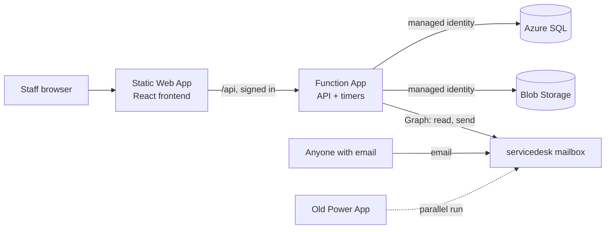

# VSB Service Desk Design

Version 3, 2026-10-02.

## Summary

The new service desk replaces the current Power App with one ticket system on
Azure. Staff use a web app or email, outside people use email only, and IT works
every ticket from one queue.

- **Two ways in.** Staff sign in with their vsb.org Microsoft account to create
  tickets and see their active and closed ones. Anyone can email
  `servicedesk@vsb.org` to open a ticket. People without a vsb.org account never
  see the app.
- **Email both ways.** Technician replies are emailed from
  `servicedesk@vsb.org`, and the requester's email replies land on the same
  ticket.
- **Automatic emails.** "Ticket received" on creation. When a ticket is waiting
  on the requester, a warning goes out after 3 business days, and the ticket
  closes automatically with a survey on business day 4.
- **Survey.** A built-in 1 to 5 rating with an optional comment, sent on every
  close.
- **IT technicians only.** One shared queue, worked by technicians. A new ticket
  emails the whole IT team, and a requester's reply emails the assigned
  technician.
- **One form that adapts to the ticket type.** The requester picks a Ticket Type
  first, and the form shows only that type's fields, in a Zendesk-style layout.
  Which fields each type shows is set in Settings.
- **Everything configurable.** Every pick-list is a lookup table managed on a
  Settings page, in a star schema.
- **More than break-fix.** Equipment rentals, event bookings, equipment
  provisioning, access requests, onboarding and offboarding are ticket types.
  Costs are tracked from inventory and per-person software licenses. There is no
  approval step.
- **Reports later.** Reports are not in the first version.
- **Switchover.** Every old ticket is imported once from a SharePoint CSV
  export, and both systems run side by side on the same mailbox while you test.

## Architecture

Everything lives in the `rg-VSB-ServiceDesk` resource group in East US. No
passwords or keys are stored anywhere: each piece signs in to the others with
Entra ID.

- **Static Web App, Standard plan.** Hosts the React frontend and handles
  sign-in. Sign-in is limited to the vsb.org tenant through its own Entra app
  registration, so outside accounts are refused at the Microsoft login screen.
- **Function App, Flex Consumption, Node 20.** Linked to the Static Web App as
  its backend, so it only accepts requests that came through the signed-in site.
  It runs the HTTP API and two timer jobs: the mailbox check every 2 minutes and
  the waiting-on-requester check every hour.
- **Azure SQL.** Your existing `db-VSB-ServiceDesk` on `sv-vsb-servicedesk`. The
  Function App signs in with its managed identity, and you sign in with your own
  account when developing locally.
- **Blob Storage.** Holds attachments in a private container. Files are only
  downloaded through the API, after it checks that the person may see the
  ticket.
- **Microsoft Graph.** The Function App's managed identity gets Mail.Read and
  Mail.Send. Exchange RBAC for Applications limits both to
  `servicedesk@vsb.org`, so it cannot touch any other mailbox.
- **Application Insights.** Collects logs and errors from the Function App.

Expected cost is about $10 to $15 a month, mostly the Static Web Apps Standard
plan.

## Database

Tickets sit at the centre of a star schema. Every pick-list is its own lookup
table, and the facts (tickets, messages, items, licenses) point at them by Id.
You run every script yourself, and I'll provide them as numbered SQL files.

### Lookup tables

Every lookup table has `Id`, `Name`, `SortOrder` and `IsActive`. Retired values
disappear from pick-lists, but old tickets keep showing them. All of them are
managed on the Settings page.

- **Statuses.** Extra columns `IsClosed`, `IsWaitingOnRequester` and `Color`.
  Starting values: New, Assigned, In Progress, Awaiting User Response (waiting),
  External Action Needed, Closed (closed).
- **Priorities.** Extra column `Rank`. Starting values: Low, Normal, High,
  Urgent.
- **Categories.** Starting values: Phone, Software/Application, iMIS,
  Printers/Copiers, Hardware, Other.
- **Subcategories.** Extra column `CategoryId`. You fill these in per category.
- **Sources.** Starting values: Web, Email, Phone, Walk-up, Import.
- **TicketTypeFields.** Which form fields each ticket type shows, and which are
  required: TicketTypeId, FieldKey, IsShown, IsRequired, SortOrder. This is how
  the form changes by type.
- **TicketTypes.** Extra columns `UsesDates`, `UsesInventory`, `UsesLicenses`
  and `UsesChecklist`. Starting values: Support, Equipment Rental, Event
  Booking, Equipment Provisioning, Access Request, Onboarding, Offboarding.
- **Departments.** Your existing table, with an added `Code` column for short
  codes like RM and AS.
- **Holidays.** Date and Name. These dates are skipped when counting business
  days.
- **UserTypes.** Starting values: Staff, External, Shared Mailbox.
- **Roles.** Starting values: Requester, Technician, Admin.
- **BillingPeriods.** Extra column `MonthsPerPeriod`. Starting values: Monthly
  (1), Yearly (12).

The `IsWaitingOnRequester` flag drives the 3 and 4 day timers, and the
`IsClosed` flag sends the survey. Because the logic follows the flags, you can
rename statuses freely.

### Catalog tables

- **InventoryItems.** Name, UnitCost (USD), QuantityOwned,
  IsDefaultForOnboarding, IsActive.
- **Software.** Name, CostPerSeat (USD), BillingPeriodId, SeatsPurchased,
  IsDefaultForOnboarding, IsActive.

### The two core tables

Ticket data and conversation data are kept apart:

- **Tickets** holds the ticket data, one row per ticket: TicketTypeId, StatusId,
  PriorityId, CategoryId, SubcategoryId, SourceId, RequesterId, ForUserId,
  TechnicianId, DepartmentId, Subject, Description, StartDate, EndDate,
  CreatedAt, UpdatedAt, WaitingSince, WarningSentAt, ClosedAt, LegacyId.
- **TicketConversations** holds the conversation, one row per response, linked
  to its ticket by TicketId: AuthorId, Body, IsTechnicianNote, Direction (in or
  out), EmailMessageId, CreatedAt.

The requester's first message is the ticket's Description. Every reply after
that, from either side, and every technician note is a row in
TicketConversations, in time order. `ForUserId` is the person the ticket is
about when that isn't the requester, such as a new hire, a leaver, or the person
getting access.

### Supporting fact tables

- **TicketCc.** One CC address on a ticket: TicketId, Email.
- **Attachments.** One file: TicketId, ConversationId (empty when attached to
  the original request), FileName, ContentType, SizeBytes, BlobPath.
- **TicketItems.** Inventory on a ticket: TicketId, InventoryItemId, Quantity,
  UnitCostAtTime, OutAt, ReturnedAt.
- **LicenseAssignments.** One seat held by one person: UserId, SoftwareId,
  CostPerSeatAtTime, AssignedAt, AssignedTicketId, RemovedAt, RemovedTicketId.
- **ChecklistItems.** One onboarding or offboarding step: TicketId, Label,
  InventoryItemId, SoftwareId, LicenseAssignmentId, IsDone, DoneById, DoneAt.
- **Surveys.** One survey per closed ticket: TicketId, Token, Rating (1 to 5),
  Comment, SentAt, AnsweredAt.
- **TicketEvents.** One field change, for history, such as a status or
  technician change: TicketId, ActorId, Field, OldValue, NewValue, At. These
  stay out of the conversation.
- **InboundEmails.** One mailbox message already processed: EmailMessageId
  (unique), ReceivedAt, TicketId.

Ticket numbers display padded to 7 digits. Imported tickets keep their old
numbers, and new tickets start at 0010000, so the two systems never use the same
number during the parallel run. `DepartmentId` is copied onto the ticket when
it's created, so moving a person to another department later doesn't rewrite
history. `UnitCostAtTime` and `CostPerSeatAtTime` freeze the price used, so a
price change doesn't rewrite past costs.

### Changes to your existing tables

- **Users.** Keep `Id` and `Email` (made unique). Add `DisplayName`,
  `UserTypeId`, `RoleId`, `DepartmentId` and `IsActive`. External senders and
  shared mailboxes are added automatically the first time they email.
- **Departments.** Add `Code`, `SortOrder` and `IsActive`.
- **UserDepartments.** Renamed `DepartmentManagers`: one row per manager per
  department, so a manager can be linked to several departments. Each person's
  own department is the single `Users.DepartmentId`.

### Settings table

One row per setting: the outgoing email switch, the 3 and 4 business-day limits,
the mailbox address, the IT team's notification addresses, the status a ticket
switches to when the requester replies, and how often to check the mailbox.

## Screens

The technician screens follow the layout your team already knows from the Power
App. The staff screens follow Zendesk.

### Staff

- **Submit a request.** Ticket Type comes first, and the rest of the form
  changes to that type's fields. The starting field sets are below, and you can
  change them in Settings.
- **My tickets.** Two tabs, Active and Closed, showing ticket number, subject,
  status, technician and last update.
- **Ticket.** The conversation without technician notes, attachments, a reply
  box, and the survey once the ticket is closed.

Starting form fields by ticket type. Every type also has Subject, Description,
Priority, CC and Attachments.

- **Support.** Category and Subcategory.
- **Equipment Rental.** Start date, end date, and the items and quantities
  needed.
- **Event Booking.** Start date, end date, and the items and quantities needed.
  The Subject holds the event name.
- **Equipment Provisioning.** Who it's for, and the items and quantities needed.
- **Access Request.** Who it's for, and the software they need.
- **Onboarding.** New hire's name, department and start date.
- **Offboarding.** Who is leaving, and their last day.

### Technicians

- **Queue.** Columns Title, Assigned To, Category, Requester, Status, Created
  Date and Department, with rows coloured by status. Filters for status,
  priority, category, type, technician and department. Search by number, subject
  or requester.
- **Ticket.** A ticket list on the left, the conversation in the middle, and a
  side panel with Status, Category, Subcategory, Priority, Type, Technician,
  Requester and Department. Below the conversation are Reply, Technician note,
  Attachments and Move to Closure.
- **Ticket extras.** Shown depending on the ticket type: start and end dates,
  inventory lines with costs, license seats, or an onboarding or offboarding
  checklist.
- **New ticket.** The staff form, plus Requester (any user, including outside
  people), Type and Source, for phone calls and walk-ups.
- **Inventory.** Item types with unit cost, quantity owned, how many are out
  now, and upcoming bookings.
- **Licenses.** Each software's seats purchased, seats in use, cost per seat and
  total cost, and who holds each seat.
- **People.** Everyone in Users, with type, department and role. Admins promote
  a user to Technician or Admin here. A person's page lists their tickets,
  equipment and licenses.

### Admin

- **Settings.** One tab per lookup table (add, rename, reorder, retire), plus
  the onboarding defaults, the email switch, the day limits and roles.

## Email flow

The app checks `servicedesk@vsb.org` every 2 minutes through Microsoft Graph. It
never moves or deletes a message, and it sends every email from
`servicedesk@vsb.org`.

### Incoming email

1. Read new messages from the mailbox's Inbox, skipping any message already
   recorded in `InboundEmails`. This lets the old Power App keep processing the
   same mailbox.
2. Skip automatic mail: out-of-office replies, delivery failures, and anything
   sent by `servicedesk@vsb.org` itself, so the app never emails itself in a
   loop.
3. Decide whether it's a reply. It is if the subject carries a ticket number
   like `[#0005689]`, or if its reply headers point at an email the app sent. A
   reply is added to that ticket.
4. Otherwise, create a ticket. Its Source is Email, its Subject and Description
   come from the email, its attachments are saved, and the people on CC are
   added to the ticket's CC list.
5. Find or create the sender in Users. Unknown vsb.org senders become Staff,
   shared mailboxes become Shared Mailbox, and everyone else becomes External.

### Outgoing email

- **Ticket created.** The requester and CC get "We received your request" with
  the ticket number. The whole IT team gets a new ticket alert with a link.
- **Technician replies.** The requester and CC get the reply text and any
  attachments.
- **Requester replies.** The assigned technician gets a reply alert with a link,
  or the whole IT team if nobody is assigned.
- **Business day 3 of waiting.** The requester gets a warning that the ticket
  closes tomorrow unless they reply.
- **Ticket closed.** The requester gets a closed notice with the 1 to 5 survey
  links, whether a technician closed it or the day-4 rule did.

Technician notes never leave the app. Every subject carries the ticket number,
like `[#0005689]`, so replies thread back to the right ticket.

### Waiting on the requester

1. When a technician replies, the status changes to Awaiting User Response
   unless the technician picks another status. Any status flagged
   `IsWaitingOnRequester` starts the clock and sets `WaitingSince`.
2. A job runs every hour on weekdays. At 3 business days with no reply from the
   requester, it sends the warning once.
3. At 4 business days, it closes the ticket, which sends the closed email with
   the survey.
4. If the requester replies at any point, the clock stops, the status switches
   to the one chosen in Settings, and the technician is emailed.

Business days are Monday to Friday, skipping any date in the Holidays list.

### The email switch for the parallel run

Settings has a three-way switch for outgoing mail:

- **Off.** Nothing is sent.
- **IT only.** Emails go only to IT team addresses, for testing.
- **On.** Emails go to everyone.

It starts at Off. Incoming email is read in every mode, so tickets keep arriving
while you test.

## Inventory, licenses, onboarding and offboarding

These are ordinary tickets with extra panels. The ticket type decides which
panels appear. Costs are recorded for tracking only and are never billed.

- **Equipment Rental.** Start date, end date and inventory lines. Items count as
  out for those dates, and the app warns you if a booking would need more than
  you own. Marking a line Returned puts the items back.
- **Event Booking.** Works the same way as a rental.
- **Equipment Provisioning.** Inventory lines with no end date. The items stay
  out until an offboarding returns them.
- **Access Request.** Software seats. Each granted seat creates a license
  assignment for that person at the current seat cost, with no approval step.
- **Onboarding.** A checklist with every inventory item and software marked as
  an onboarding default already ticked. The technician unticks or adds items,
  and each ticked line becomes a provisioning line or a seat.
- **Offboarding.** A checklist of everything the person currently holds. Marking
  a line done returns the equipment or frees the seat.
- **Support.** No extra panel.

The numbers are worked out like this:

- **Available now** = quantity owned − items out today − items booked for today.
- **Ticket cost** = the sum of quantity × unit cost for its inventory lines,
  plus the seat cost of any licenses it granted.
- **License spend** = active seats × cost per seat, shown monthly and yearly
  using each software's billing period.
- **Prices are frozen.** The price is saved on each line, so changing a price in
  Settings later doesn't change past costs.

## Migration and parallel run

Old tickets come over once from a CSV export, and then both systems run side by
side until you switch off the Power App.

1. **Export.** You export the SharePoint lists behind the Power App to CSV:
   tickets, plus any separate lists for notes, rentals or access requests. I'll
   need a sample of each before writing the import.
2. **Import.** A Node script you run once loads the CSVs into the new tables. It
   keeps each old ticket number, creates any lookup value it doesn't recognise
   (a status or category name, for example), and matches requesters by email,
   creating any that are missing. Each imported ticket gets Source Import and
   its original `LegacyId`.
3. **Attachments.** The import also copies each old ticket's SharePoint
   attachments into Blob Storage through Microsoft Graph. This step is optional,
   and can be skipped if it proves difficult, leaving the files in SharePoint.
4. **Check.** The script prints counts per status and category so you can
   compare them with the Power App.
5. **Parallel run.** Both systems read `servicedesk@vsb.org`. The new app's
   email switch stays at Off or IT only, so people only get emails from the old
   system.
6. **Cutover.** Turn the email switch to On, then stop the Power App's email
   flow.

Tickets created in the old system after the export won't be imported. New
tickets start at 0010000, so they never clash with the old system's numbers.

## Azure setup steps

You do these yourself as global admin. The build will include a README with the
exact commands for each step.

1. Run the SQL scripts against `db-VSB-ServiceDesk` in order.
2. Create a Storage account with a private `attachments` container.
3. Create the Function App (Flex Consumption, Node 20, East US) and turn on its
   system-assigned managed identity.
4. Give that identity access: a contained SQL user with read and write roles,
   Storage Blob Data Contributor on the storage account, and the Graph app roles
   Mail.Read and Mail.Send.
5. Limit the mail access to `servicedesk@vsb.org` with an Exchange RBAC for
   Applications management scope, using Exchange Online PowerShell.
6. Create an Entra app registration for sign-in, single tenant, with the Static
   Web App's callback URL.
7. Create the Static Web App on the Standard plan, connect it to
   `Virginia-State-Bar/ServiceDesk`, and link the Function App as its backend.
8. Add the app settings: SQL server and database names, storage account name,
   mailbox address and the sign-in app's client ID and secret setting.
9. Make yourself Admin by running the provided SQL script, then sign in and fill
   in the lookup tables on the Settings page.

## Build order

Each step is its own pull request to `Virginia-State-Bar/ServiceDesk`, so you
can review and test as it lands.

1. **Database.** The SQL scripts and starting lookup values.
2. **API core.** Sign-in, users, lookups, settings, tickets, messages and
   attachments.
3. **Frontend.** The staff form, My tickets, the technician queue and ticket
   page, and the Settings page.
4. **Email.** Reading the mailbox, sending email, notifications and the email
   switch.
5. **Timers and survey.** The 3 and 4 business-day rules and the survey page.
6. **Inventory and licenses.** Item and software catalogs, ticket panels, and
   the onboarding and offboarding checklists.
7. **Import.** The one-time CSV import script.
8. **Parallel run and cutover.**
